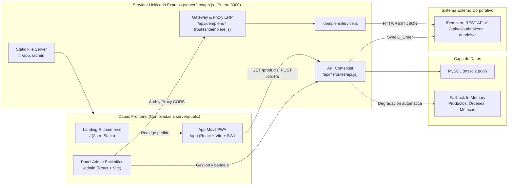

# ARCHITECTURE.md — Arquitectura del Sistema Hamburger Rapid

Documentación técnica oficial de la arquitectura del monorepo **Hamburger Rapid (`nextcollege-masterclass-scaffold`)**, diseñada como plataforma omnicanal de 3 capas conectada a un backend unificado en Node.js y pasarela REST hacia iDempiere ERP.

> **Regla de mantenimiento obligatorio:** Este archivo [`ARCHITECTURE.md`](ARCHITECTURE.md) debe mantenerse **siempre actualizado junto con [`AGENTS.md`](AGENTS.md)** conforme avance el proyecto (nuevas funcionalidades, componentes, rutas, endpoints, esquemas, variables de entorno o flujos de despliegue). Ninguna tarea se da por cerrada sin reflejar los cambios en ambos documentos `.md`.

---

## 1. Diagrama General de Arquitectura



---

## 2. Estructura del Repositorio

```text
scaffold_base/
├── AGENTS.md                           # Reglas y convenciones vivas para desarrollo/agentes
├── ARCHITECTURE.md                     # Este documento técnico
├── Dockerfile                          # Build multi-etapa (4 stages) sobre node:20-alpine
├── package.json                        # Scripts raíz del monorepo
├── README.md                           # Guía general de despliegue e instalación
│
├── apps/
│   ├── ecommerce/                      # Capa 1: Landing Page SSG con Astro 4
│   │   ├── astro.config.mjs            # output: 'static', format: 'directory'
│   │   ├── package.json
│   │   └── src/pages/index.astro       # Hero, Bestsellers, 10 hamburguesas, #detailModal
│   │
│   ├── pwa/                            # Capa 2: Progressive Web App Mobile (Vite port 5173)
│   │   ├── index.html                  # Registro de /app/sw.js y meta tags PWA
│   │   ├── vite.config.js              # base: '/app/', proxy /api -> :3000
│   │   ├── public/
│   │   │   ├── manifest.json           # start_url: '/app/', display: standalone
│   │   │   ├── sw.js                   # Service Worker nextcollege-pwa-v2
│   │   │   ├── icon-192.svg
│   │   │   └── icon-512.svg
│   │   └── src/
│   │       ├── App.jsx                 # 5 tabs, carrito, cupones, tracking, fallback offline
│   │       ├── index.css
│   │       └── main.jsx
│   │
│   └── admin/                          # Capa 3: Backoffice Administrativo (Vite port 5174)
│       ├── index.html
│       ├── vite.config.js              # base: '/admin/', proxy /api -> :3000
│       └── src/
│           ├── App.jsx                 # Orquestador del Control Dashboard + vistas
│           ├── index.css               # Estilos base y responsive sidebar/login
│           ├── main.jsx
│           ├── context/
│           │   └── AuthContext.jsx     # Estado reactivo sobre AuthService
│           ├── services/
│           │   └── AuthService.js      # Cliente iDempiere v1 reutilizable sin deps UI
│           └── components/
│               ├── AuthGuard.jsx       # Guardia de ruta autenticada (Bearer token)
│               ├── LoginPage.jsx       # Login público white-label
│               ├── TwoStepContextForm.jsx # Selector multitenant dinámico (Paso 2)
│               ├── AdminSidebar.jsx    # Barra lateral del panel de control
│               ├── OrdersInbox.jsx     # Bandeja 3-capas (PWA vs E-commerce + ERP sync)
│               ├── IdempiereErpView.jsx # Consola técnica REST v1 + diagnóstico Ping
│               ├── ErpStatusModal.jsx  # Modal Inspector de Sesión y JWT Bearer
│               └── ProfileErpSettingsView.jsx # Configuración segura de servidor, modo login y catálogo
│
└── server/                             # Backend Node.js / Express + Artefactos servidos
    ├── package.json                    # express ^4.19.2, cors ^2.8.5, mysql2 ^3.10.1
    └── src/
        ├── app.js                      # Servidor HTTP unificado, CORS, rutas y static SPA
        ├── db.js                       # Pool MySQL + fallback In-Memory (productos/órdenes/clientes)
        ├── routes/
        │   ├── api.js                  # Endpoints comerciales, órdenes, salud y diagnóstico
        │   └── idempiere.js            # Proxy CORS, gateway auth REST v1 y sync catálogo
        └── services/
            └── idempiereService.js     # Cliente backend para iDempiere REST API v1
```

---

## 3. Detalle Técnico por Capa

### 3.1 Capa 1 — Portal E-commerce (`apps/ecommerce`)
- **Framework**: Astro `^4.16.18` compilado estáticamente (`output: 'static'`).
- **Funcionalidad**: Landing Page comercial de **Hamburger Rapid** montada en `/` por Express.
- **Catálogo**: Renderiza 10 variantes de hamburguesas (incluyendo *Rey de las Burgers*, *Burger Real Clásica*, *Burger Real Doble* y *Burger Doble Especial*) con precio, calorías, proteína, badge de nivel de especialidad, filtro por categoría (`all`, `especiales`, `clasicas`, `pollo`) y modal interactivo `#detailModal` activado por el botón `Ver Detalles`.
- **Conversión**: los botones de pedido redirigen directamente hacia `/app`.

### 3.2 Capa 2 — PWA de Pedidos (`apps/pwa`)
- **Framework**: React `18.3.1` + Vite `5.3.1` (`base: '/app/'`).
- **Capacidades PWA**:
  - `manifest.json` configurado en `scope: '/app/'`, orientación vertical y `display: standalone`.
  - `sw.js` (`CACHE_NAME = 'nextcollege-pwa-v2'`): estrategia **Network-First** para navegación HTML (evita servir vistas obsoletas) y **Cache-First** para assets estáticos (`sw` excluye `/api/` para mantener integridad transaccional).
- **Navegación por 5 Pestañas**:
  1. `home`: hero promocional, buscador en vivo, selector de categorías dinámico y combos populares.
  2. `menu`: catálogo completo filtrable por categoría y favoritos.
  3. `ordenes`: historial y stepper en vivo de progreso (`Recibido` → `Cocina` → `En camino` → `Entregado`).
  4. `ofertas`: cupones comerciales (`RAPID2X1`, `COMBODOBLE`, `SPICY30`, `DELIVERYFREE`).
  5. `perfil`: datos del usuario, recompensas, dirección y enlaces al portal `/` y panel `/admin`.
- **Resiliencia Offline**: sincroniza con `GET /api/products` y `GET /api/orders` al montar; ante desconexión opera con `DEFAULT_PRODUCTS` y registra órdenes localmente, o envía `channel: 'PWA Mobile'` vía `POST /api/orders` cuando hay red.

### 3.3 Capa 3 — Panel de Administración (`apps/admin`)

#### Módulo de Autenticación Desacoplado y White-Label
- **[`AuthService.js`](apps/admin/src/services/AuthService.js)**: librería pura en JavaScript (sin dependencia de React) diseñada para ser reutilizable también desde la PWA.
  - **Almacenamiento en navegador (`localStorage`)**:
    - `idempiere_auth_session`: `{ token, refreshToken, userId, userName, clientId, roleId, orgId, organizationId, warehouseId, language, clientName, roleName, orgName, warehouseName, authMode, endpoint, baseUrl, corsProxyEnabled, corsProxyMode, viaProxy, latencyMs, claims, expiresAt, savedAt }`.
    - `idempiere_connection_config`: `{ baseUrl, corsProxyEnabled, corsProxyMode, corsProxyCustomUrl, enableMultiTenantLogin, defaultParameters }`.
  - **Soporte Dual de Login**:
    - **1 Paso (`loginDirect`)**: `POST /api/v1/auth/tokens` con bloque `parameters: { clientId, roleId, organizationId, warehouseId, language }`.
    - **2 Pasos (`loginStepOne` + `loginStepTwo`)**: autenticación inicial + carga en cascada (`/roles`, `/organizations`, `/warehouses`, `/language`) + `PUT /api/v1/auth/tokens` con token temporal en cabecera `Authorization: Bearer`.
  - **Estrategias CORS (`resolveUrl`)**: conexión directa HTTPS, Proxy Local del backend (`/api/idempiere/proxy?url=...`), `https://corsproxy.io/?` o URL personalizada.
- **Separación de Responsabilidades (Seguridad Pública vs Control Interno)**:
  - **`LoginPage.jsx` + `AuthGuard.jsx` + `TwoStepContextForm.jsx`**: interfaz corporativa limpia white-label; oculta URL del servidor, Proxy CORS, IDs numéricos por defecto, modo multi-tenant y toda mención a iDempiere. Los errores de autenticación devolviendo códigos `400/401/403/404` se traducen a mensajes neutros comprensibles para el usuario final.
  - **`ProfileErpSettingsView.jsx`**: consola interna solo accesible tras autenticar sesión; administra la URL corporativa, proxy CORS, activación de modo asistido 2 pasos (`enableMultiTenantLogin`), valores predeterminados para 1 paso (`defaultParameters`, incluyendo idioma `es_PE`) y aprovisionamiento de catálogo.

#### Secciones del Control Dashboard
1. **`Resumen General`** (`resumen`): 4 tarjetas KPI ejecutivas + bandeja central de pedidos integrada.
2. **`Catálogo Hamburguesas`** (`burgers`): listado, filtros por categoría, búsqueda, alta (`POST /api/products`), activación/pausa (`PATCH /api/products/:id/toggle`) y eliminación (`DELETE /api/products/:id`).
3. **`Bandeja Pedidos`** (`orders` — [`OrdersInbox.jsx`](apps/admin/src/components/OrdersInbox.jsx)): filtrado por canal (*PWA Preventa / Vendedores* vs *E-commerce*), cambio de estado (`PATCH /api/orders/:id/status`) y coordinación de orden de venta `C_Order` hacia el ERP (`POST /api/orders/:id/sync-erp`).
4. **`Métricas de Clientes`** (`customers`): KPIs de consumo, segmentación VIP / Frecuente / Ocasional y ranking de clientes (`GET /api/metrics/customers`).
5. **`Estado Base de Datos`** (`database`): modo activo (`mysql` vs `in-memory`), métricas de pool, prueba de latencia (`/api/health`) y diagnóstico de red (`/api/debug-network`).
6. **`iDempiere ERP`** (`idempiere` — [`IdempiereErpView.jsx`](apps/admin/src/components/IdempiereErpView.jsx) & [`ErpStatusModal.jsx`](apps/admin/src/components/ErpStatusModal.jsx)): auditoría visual de directivas REST v1 (`POST /api/v1/auth/tokens`, objeto `parameters`, campo `organizationId`), payload sanitizado transmitido, diagnóstico Ping y visor completo del Bearer Token / JWT.
7. **`Perfil & Conexión ERP`** (`profile` — [`ProfileErpSettingsView.jsx`](apps/admin/src/components/ProfileErpSettingsView.jsx)): perfil de sesión activa, configuración segura de servidor/CORS, modo de autenticación público, parámetros predeterminados y aprovisionamiento/sincronización de catálogo.

---

## 4. API Backend y Contratos de Datos (`server/`)

Montado en [`server/src/app.js`](server/src/app.js) bajo puerto `process.env.PORT || 3000`:

### 4.1 Endpoints Comerciales (`/api`, `server/src/routes/api.js`)
| Método | Ruta | Descripción |
| :--- | :--- | :--- |
| `GET` | `/api/health` | Estado del servidor, modo de base de datos y conteos |
| `GET` | `/api/products` | Lista completa del catálogo (MySQL o In-Memory) |
| `POST` | `/api/products` | Crea una nueva variante en el catálogo |
| `PATCH` | `/api/products/:id/toggle` | Alterna disponibilidad (`isAvailable`) |
| `DELETE` | `/api/products/:id` | Elimina un producto del catálogo |
| `POST` | `/api/reset` | Restaura las 10 hamburguesas iniciales |
| `GET` | `/api/metrics/customers` | Métricas de consumo agregadas y top clientes |
| `GET` | `/api/orders` | Lista órdenes (soporta `?origin=pwa\|ecommerce`) |
| `POST` | `/api/orders` | Registra nueva orden desde PWA o E-commerce |
| `PATCH` | `/api/orders/:id/status` | Actualiza estado operativo de una orden |
| `POST` | `/api/orders/:id/sync-erp` | Requiere `Authorization: Bearer` y envía `C_Order` al ERP |
| `GET` | `/api/debug-network` | Diagnóstico DNS y escaneo de puertos 3306 en red Docker |

### 4.2 Endpoints Gateway & Catálogo (`/api/idempiere`, `server/src/routes/idempiere.js`)
| Método | Ruta | Descripción |
| :--- | :--- | :--- |
| `ALL` | `/api/idempiere/proxy?url=...` | Proxy CORS restringido a rutas `/api/v1/` con timeout 12s |
| `POST` | `/api/idempiere/authenticate` | Paso 1 server-side |
| `POST` | `/api/idempiere/login` | Login 1 paso o confirmación Paso 2 server-side |
| `GET` | `/api/idempiere/status` | Ping HTTP de conectividad ERP |
| `POST` | `/api/idempiere/verify` | Decodifica y verifica vigencia (`exp`) de token JWT |
| `POST` | `/api/idempiere/logout` | Notifica cierre de sesión |
| `POST` | `/api/idempiere/catalog/seed` | Mapea/verifica catálogo en ERP (`M_Product`) con token Bearer |
| `POST` | `/api/idempiere/catalog/sync-sqlite` | Sincroniza IDs `M_Product_ID` y precios hacia datamart activo |
| `GET` | `/api/idempiere/catalog/history` | Retorna historial reciente de aprovisionamiento y sincronización |

### 4.3 Esquema de Datos y Variables de Entorno (`server/src/db.js`)
- **Variables de entorno soportadas**:
  - `PORT` (por defecto `3000`), `NODE_ENV`
  - `DATABASE_URL` o combinación `DB_HOST`, `DB_PORT` (`3306`), `DB_USER`, `DB_PASSWORD`, `DB_NAME`
  - `IDEMPIERE_BASE_URL` (por defecto `https://test.idempiere.org:443`)
- **Tabla MySQL `products`** creada automáticamente en `db.initDB()`:
  - `id` (`INT AUTO_INCREMENT PK`), `name`, `category`, `price` (`DECIMAL(10,2)`), `stock`, `specialty`, `badgeColor`, `calories`, `image`, `description`, `isAvailable` (`BOOLEAN`), `created_at` (`TIMESTAMP`).
- **Respaldo In-Memory**: cuando MySQL no está disponible al arranque, `db.js` mantiene las colecciones `inMemoryProducts` (10 hamburguesas), `inMemoryOrders` (órdenes multicanal de ejemplo con `originType` `pwa`/`ecommerce`) y `inMemoryCustomers` (7 clientes con consumo).

---

## 5. Despliegue en Contenedor (`Dockerfile`)

El [`Dockerfile`](Dockerfile) ejecuta una compilación aislada de **4 etapas** sobre `node:20-alpine`:
1. **`builder-ecommerce`**: instala dependencias de `apps/ecommerce` y ejecuta `npm run build`.
2. **`builder-pwa`**: instala dependencias de `apps/pwa` y ejecuta `npm run build`.
3. **`builder-admin`**: instala dependencias de `apps/admin` y ejecuta `npm run build`.
4. **`runner`**: instala dependencias de producción en `server/`, copia `server/` junto con las 3 salidas `dist/` hacia `./server/public/{ecommerce,pwa,admin}`, expone el puerto `3000` y arranca con `node server/src/app.js`.

