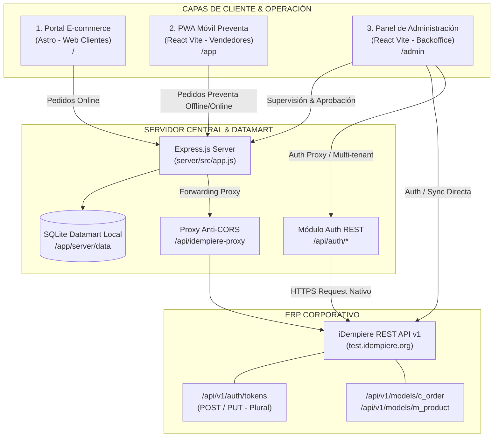
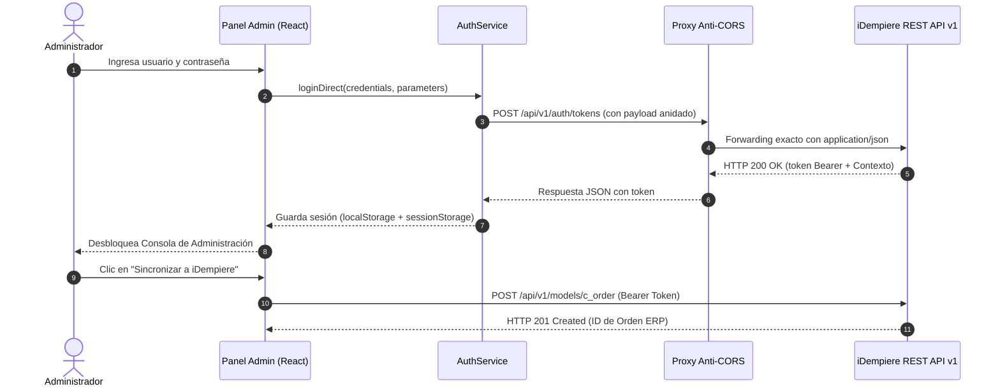

# Arquitectura de la Solución RapidFood &bull; iDempiere ERP

Documento técnico oficial que describe la arquitectura de software, el flujo de datos entre capas, los modelos de integración con iDempiere ERP y las estrategias de despliegue de **RapidFood**.

---

## 1. Visión General del Sistema

RapidFood es una plataforma integral de comida rápida de alta concurrencia diseñada bajo una arquitectura modular de **3 capas desacopladas**, complementadas por un **servidor central de coordinación** y un **ERP corporativo (iDempiere)**:



---

## 2. Detalle de las 3 Capas de la Aplicación

### Capa 1: Portal E-commerce (`apps/ecommerce`)
* **Tecnología:** [Astro 4.x](https://astro.build/) (Static Site Generation / Islands Architecture).
* **Propósito:** Portal web para navegación y compra directa de consumidores finales.
* **Características:**
  * Carga ultrarrápida sin sobrecarga de JavaScript innecesario en la vista principal.
  * Branding: *"Burger Factory &bull; Burgers Done Right"*.
  * Catálogo de 10 variantes de hamburguesas de autor (*Rey de las Burgers, Burger Real Clásica, Burger Real Doble, etc.*).
  * Modal interactivo de detalle con tiempos de preparación, calorías, alérgenos y ratings.
  * Carrito de compras y banner promocional de upgrades a combos.
* **Ruta de Despliegue:** Servido en la raíz `/` del servidor Express.

### Capa 2: PWA Móvil de Preventa (`apps/pwa`)
* **Tecnología:** React 18 + Vite + Service Worker PWA.
* **Propósito:** Herramienta móvil utilizada por la fuerza de ventas en terreno y por clientes que prefieren una experiencia tipo aplicación nativa instalable.
* **Características:**
  * **Conmutador dinámico de Tema:** Soporte integral para **Modo Dark** y **Modo Claro / Light** en tiempo real.
  * **Pestañas Inferiores:**
    1. **Menú:** Catálogo vertical con filtros por categoría (*Especiales, Clásicas, Gourmet, Pollo/Veggie*) y buscador de ingredientes.
    2. **Ofertas:** Gestión de cupones promocionales (`REY20` para -20% y `COMBO50` para -15%).
    3. **Órdenes:** Historial de pedidos realizados, estado de preparación en cocina y confirmación de sincronización a ERP.
    4. **Perfil:** Datos del vendedor/cliente, nivel VIP Gold (con puntos acumulados) y enlaces de navegación al ecosistema.
  * **Simulación de Compra:** Permite configurar pedidos (extra panceta, extra queso, combo) y realizar el checkout simulado.
* **Ruta de Despliegue:** Servido en el subpath `/app` con `base: '/app/'` en Vite.

### Capa 3: Panel de Control & Administración (`apps/admin`)
* **Tecnología:** React 18 + Vite + Context API + iDempiere REST Client.
* **Propósito:** Consola central de backoffice donde se supervisan indicadores de negocio, se auditan pedidos de ambas capas y se gestiona la sincronización con iDempiere ERP.
* **Módulos Principales:**
  1. **Acceso Seguro *"Tasty Bites • Central"*:** Login simple y elegante (2 campos) protegido por `AuthGuard`.
  2. **Inspector de Sesión Modal (*"Token Info"*):** Auditoría en vivo de tokens Bearer, parámetros de contexto ERP y directivas de blindaje técnico.
  3. **Resumen General:** Dashboard con KPIs de ventas, hamburguesas activas, clientes consumidores segmentados por nivel (VIP Gold, Regulares, Ocasionales) y catálogo destacado.
  4. **Bandeja Central de Gestión de Pedidos:** Filtrado por origen (*PWA Preventa vs E-commerce*), estado ERP (*Sincronizado, Pendiente, Error*) y modal interactivo para inspeccionar el payload `C_Order`.
  5. **Integración iDempiere ERP v1 (Live):** Diagnóstico de conexión en tiempo real (*"Probar Ping"* con cálculo de latencia en milisegundos).
  6. **Perfil de Administrador & Configuración ERP:** Conmutador de modo 1 paso (directo) vs. 2 pasos (asistido multi-tenant), configuración de URLs de servidor, proxies CORS y siembra de catálogo hacia `M_Product`.
* **Ruta de Despliegue:** Servido en el subpath `/admin` con `base: '/admin/'` en Vite.

---

## 3. Servidor Backend & Datamart Local (`server`)

* **Tecnología:** Node.js 24 + Express 4.x + **SQLite Datamart de Alto Rendimiento (`better-sqlite3`)**.
* **Configuración del Motor SQLite:**
  * Modo WAL (`journal_mode = WAL`) para lectura/escritura concurrente sin bloqueos.
  * Sincronización normal (`synchronous = NORMAL`).
  * Integridad referencial activada (`foreign_keys = ON`).
  * Persistencia en disco: `server/data/database.sqlite` (configurable vía variable `DATA_DIR` y `SQLITE_FILE`).
* **Estructura de Rutas y APIs:**
  * **Autenticación iDempiere:**
    * `POST /api/auth/login`: Autenticación 1-Paso / 2-Pasos hacia iDempiere con validación de `parameters` y fallback Sandbox.
    * `POST /api/auth/context`: Consulta dinámica multitenant (Paso 1) de Tenants, Roles, Organizaciones y Almacenes (asociación en cascada).
    * `POST /api/auth/warehouses`: Consulta dinámica de almacenes filtrados por organización.
    * `POST /api/auth/step2`: Confirmación y emisión de token definitivo vía `PUT /api/v1/auth/tokens`.
    * `POST /api/auth/verify`: Verificación de tokens Bearer activos.
    * `GET /api/auth/config`: Parámetros y credenciales predeterminadas de GardenWorld.
    * `POST /api/auth/test-connection`: Ping y diagnóstico directo a la URL de iDempiere.
  * **Catálogos Maestros de Solo Lectura (Fuente de la Verdad: iDempiere ERP):**
    * `GET /api/product-categories`: Consulta de categorías de productos (`M_Product_Category`). Retorna `readOnly: true`. Mutaciones locales bloqueadas con `HTTP 405 Method Not Allowed`.
    * `GET /api/products`: Consulta de productos (`M_Product`). Retorna `readOnly: true`. Mutaciones locales bloqueadas con `HTTP 405 Method Not Allowed`.
    * `GET /api/taxes`: Consulta de tasas e impuestos (`C_Tax`). Retorna `readOnly: true`. Mutaciones locales bloqueadas con `HTTP 405 Method Not Allowed`.
  * **Catálogos Maestros con Mantenimiento Local (CRUD):**
    * `/api/price-lists`, `/api/price-list-versions`, `/api/product-prices`: CRUD para listas, versiones y tarifas (`M_PriceList`, `M_PriceList_Version`, `M_ProductPrice`).
    * `/api/customer-categories`: CRUD para categorías de socios de negocio (`C_BP_Group`).
    * `/api/customers`: CRUD para clientes y socios (`C_BPartner`).
  * **Sincronización y Auditoría:**
    * `POST /api/sync/:catalog`: Sincronización masiva transaccional con resolución `ON CONFLICT(id) DO UPDATE SET`.
    * `GET /api/sync/logs`: Historial y auditoría de sincronizaciones registradas en `sync_logs`.
  * **Infraestructura & Proxy:**
    * `GET /api/health`: Healthcheck y telemetría de base de datos (`stats` de productos, categorías, listas, clientes e impuestos).
    * `ALL /api/idempiere-proxy?target=`: Proxy local server-to-server que reenvía peticiones evitando bloqueos de CORS.
  * **Servicio Estático de las 3 Aplicaciones:**
    * `GET /`: Sirve el build de Astro (`server/public/ecommerce`).
    * `GET /app/*`: Sirve la SPA PWA Móvil (`server/public/pwa`).
    * `GET /admin/*`: Sirve la SPA del Panel de Control (`server/public/admin`).

---

## 3.1. Esquemas Relacionales SQLite (Datamart Local)

| Tabla | Modelo iDempiere ERP | Propósito | Operaciones Permitidas |
| :--- | :--- | :--- | :--- |
| `product_categories` | `M_Product_Category` | Clasificación de productos | **Estrictamente SOLO LECTURA** (Sync ERP unidireccional) |
| `products` | `M_Product` | Catálogo maestro de artículos | **Estrictamente SOLO LECTURA** (Sync ERP unidireccional) |
| `price_lists` | `M_PriceList` | Listas de precios corporativas | Lectura, Creación, Edición, Eliminación, Sync ERP |
| `price_list_versions` | `M_PriceList_Version` | Versiones temporales de listas | Lectura, Sync ERP |
| `product_prices` | `M_ProductPrice` | Precios específicos por producto | Lectura, Creación, Edición, Eliminación, Sync ERP |
| `customer_categories` | `C_BP_Group` | Grupos de socios de negocio | Lectura, Creación, Edición, Eliminación, Sync ERP |
| `customers` | `C_BPartner` | Directorio de clientes y proveedores | Lectura, Creación, Edición, Eliminación, Sync ERP |
| `taxes` | `C_Tax` | Tasas tributarias e impuestos | **Estrictamente SOLO LECTURA** (Sync ERP unidireccional) |
| `sync_logs` | *N/A (Auditoría Interna)* | Historial de sincronizaciones ERP | Lectura y registro automático |


---

## 4. Integración con iDempiere ERP REST API v1



### Directivas Estrictas de Blindaje Técnico

1. **Ruta Exacta en Plural:**
   - La emisión y revalidación de tokens se realiza obligatoriamente en `POST /api/v1/auth/tokens`.
   - Se prohíbe el uso de `/token` (en singular), ya que no está registrado en el servlet REST de iDempiere y genera `HTTP 404 Not Found`.

2. **Cabeceras HTTP Obligatorias:**
   - `Content-Type: application/json`
   - `Accept: application/json`
   - `Authorization: Bearer <token>` (en peticiones a modelos de negocio).

3. **Estructura Anidada `"parameters"` y `"organizationId"`:**
   - Los parámetros de contexto (`clientId`, `roleId`, `organizationId`, `warehouseId`, `language`) **deben estar obligatoriamente anidados** dentro del objeto `"parameters"`.
   - El identificador de organización debe llamarse `"organizationId"` (nunca `"orgId"`).
   - *Razón técnica:* Jackson y Gson en iDempiere mapean esta carga útil a la clase Java `com.trekglobal.idempiere.rest.api.v1.auth.LoginCredential`. Si los campos están en la raíz o usan claves incorrectas, la deserialización Java falla produciendo `HTTP 400 Bad Request`.

---

## 5. Mapeo de Modelos de Negocio hacia iDempiere

### Pedido de Venta (`C_Order`)

```json
{
  "AD_Client_ID": { "id": 11 },
  "AD_Org_ID": { "id": 11 },
  "M_Warehouse_ID": { "id": 103 },
  "C_DocTypeTarget_ID": { "id": 1000030 },
  "Description": "[PWA PREVENTA] Pedido PED-2026-001 - Restaurante El Gourmet",
  "DateOrdered": "2026-11-10",
  "C_BPartner_ID": { "id": 1000001 },
  "C_PaymentTerm_ID": { "id": 1000000 },
  "M_PriceList_ID": { "id": 1000000 },
  "lines": [
    {
      "Line": 10,
      "M_Product_ID": { "id": 1000001 },
      "QtyOrdered": 2,
      "PriceActual": 14.99,
      "PriceEntered": 14.99
    }
  ]
}
```

---

## 6. Estructura de Directorios del Repositorio

```
rapidfood_with_erp/
├── AGENTS.md                  # Manual operativo y directivas para agentes de IA
├── ARCHITECTURE.md            # Documento técnico de arquitectura (este archivo)
├── Dockerfile                 # Contenedor multi-stage para Dokploy CI/CD
├── package.json               # Scripts raíz para orquestación de builds
├── apps/
│   ├── ecommerce/             # Capa 1: Portal Web Clientes (Astro)
│   │   └── src/pages/index.astro
│   ├── pwa/                   # Capa 2: PWA Móvil Preventa (React + Vite)
│   │   └── src/
│   │       ├── App.jsx        # App móvil con 4 tabs y temas Dark/Light
│   │       └── index.css      # Estilos responsivos tipo app nativa
│   └── admin/                 # Capa 3: Panel de Control & ERP Sync (React + Vite)
│       └── src/
│           ├── components/
│           │   ├── AuthGuard.jsx              # Protección de rutas por token
│           │   ├── LoginPage.jsx              # Pantalla de Login homologada con laboratorio1 (Imagen 1)
│           │   ├── LoginView.jsx              # Alias compatible de LoginPage
│           │   ├── DashboardLayout.jsx        # Layout con sidebar modular
│           │   ├── TokenInfoModal.jsx         # Inspector modal de sesión ERP
│           │   ├── IdempiereInspectorModal.jsx # Auditoría técnica homologada con laboratorio1
│           │   ├── GeneralSummaryView.jsx     # KPIs y distribución de clientes
│           │   ├── OrderManagement.jsx        # Bandeja central de pedidos 3 capas
│           │   ├── IDempiereIntegrationView.jsx # Diagnóstico y ping ERP en vivo
│           │   ├── BurgerCatalogView.jsx      # Gestión de stock de 10 variantes
│           │   ├── CustomerMetricsView.jsx    # Segmentación LTV
│           │   ├── DatabaseStatusView.jsx     # Estado del Datamart
│           │   └── ProfileConfigView.jsx      # Configuración 1 paso vs. 2 pasos
│           ├── context/
│           │   └── AuthContext.jsx            # Estado global de autenticación homologado
│           └── services/
│               ├── authService.js             # Configuración y utilidades de red
│               ├── idempiereAuthService.js     # Cliente REST v1 blindado (1-paso, 2-pasos, direct/proxy)
│               └── idempiereClient.js         # Consumo y sincronización C_Order
└── server/                    # Servidor Central & Proxy (Express)
    ├── src/
    │   ├── app.js             # Despachador de rutas / , /app, /admin y /api
    │   ├── routes/
    │   │   ├── api.js         # Endpoint /api/health y /api/idempiere-proxy
    │   │   └── auth.js        # Endpoints /api/auth/* homologados con laboratorio1
    │   └── services/
    │       └── idempiereService.js # Servicio backend HTTPS nativo con fallback Sandbox
    └── public/                # Directorio donde se sincronizan los 3 builds
```

---

## 7. Despliegue y CI/CD con Dokploy

El proyecto está preparado para compilación y despliegue automatizado mediante el `Dockerfile` raíz:
1. **Etapa de Construcción:** Instala dependencias y compila cada frontend (`build:ecommerce`, `build:pwa`, `build:admin`).
2. **Etapa de Sincronización:** Copia los artefactos a `server/public`.
3. **Etapa de Ejecución:** Lanza el proceso Node.js en modo producción (`CMD ["npm", "start"]`), sirviendo las 3 capas bajo un único puerto HTTP expuesto.

