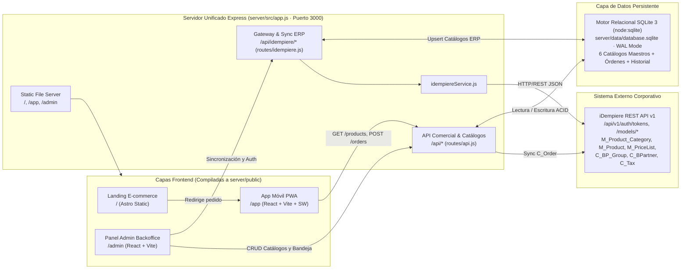

# ARCHITECTURE.md — Arquitectura del Sistema Hamburger Rapid

Documentación técnica oficial de la arquitectura del monorepo **Hamburger Rapid (`nextcollege-masterclass-scaffold`)**, diseñada como plataforma omnicanal de 3 capas conectada a un backend unificado en Node.js, base de datos relacional SQLite 3 y pasarela REST hacia iDempiere ERP.

> **Regla de mantenimiento obligatorio:** Este archivo [`ARCHITECTURE.md`](ARCHITECTURE.md) debe mantenerse **siempre actualizado junto con [`AGENTS.md`](AGENTS.md)** conforme avance el proyecto (nuevas funcionalidades, componentes, rutas, endpoints, esquemas, variables de entorno o flujos de despliegue). Ninguna tarea se da por cerrada sin reflejar los cambios en ambos documentos `.md`.

---

## 1. Diagrama General de Arquitectura



---

## 2. Estructura del Repositorio

```text
scaffold_base/
├── AGENTS.md                           # Reglas y convenciones vivas para desarrollo/agentes
├── ARCHITECTURE.md                     # Este documento técnico oficial
├── Dockerfile                          # Build multi-etapa (4 stages) sobre node:22-alpine + volumen SQLite
├── package.json                        # Scripts raíz del monorepo
├── README.md                           # Guía general de despliegue e instalación
│
├── apps/
│   ├── ecommerce/                      # Capa 1: Landing Page SSG con Astro 4
│   │   ├── astro.config.mjs            # output: 'static', format: 'directory'
│   │   ├── package.json
│   │   └── src/pages/index.astro       # Hero, Bestsellers, 10 hamburguesas, #detailModal
│   │
│   ├── pwa/                            # Capa 2: Progressive Web App Mobile (Vite port 5173)
│   │   ├── index.html                  # Registro de /app/sw.js y meta tags PWA
│   │   ├── vite.config.js              # base: '/app/', proxy /api -> :3000
│   │   ├── public/
│   │   │   ├── manifest.json           # start_url: '/app/', display: standalone
│   │   │   ├── sw.js                   # Service Worker nextcollege-pwa-v2
│   │   │   ├── icon-192.svg
│   │   │   └── icon-512.svg
│   │   └── src/
│   │       ├── App.jsx                 # 5 tabs, carrito, cupones, tracking, fallback offline
│   │       ├── index.css
│   │       └── main.jsx
│   │
│   └── admin/                          # Capa 3: Backoffice Administrativo (Vite port 5174)
│       ├── index.html
│       ├── vite.config.js              # base: '/admin/', proxy /api -> :3000
│       └── src/
│           ├── App.jsx                 # Orquestador del Control Dashboard + vistas
│           ├── index.css               # Estilos base y responsive sidebar/login
│           ├── main.jsx
│           ├── context/
│           │   └── AuthContext.jsx     # Estado reactivo sobre AuthService
│           ├── services/
│           │   └── AuthService.js      # Cliente iDempiere v1 reutilizable sin deps UI
│           └── components/
│               ├── AuthGuard.jsx       # Guardia de ruta autenticada (Bearer token)
│               ├── LoginPage.jsx       # Login público white-label
│               ├── TwoStepContextForm.jsx # Selector multitenant dinámico (Paso 2)
│               ├── AdminSidebar.jsx    # Barra lateral del panel con accesos a catálogos
│               ├── MasterCatalogsView.jsx # Módulo de los 6 catálogos maestros y sincronización ERP
│               ├── OrdersInbox.jsx     # Bandeja 3-capas (PWA vs E-commerce + ERP sync)
│               ├── IdempiereErpView.jsx # Consola técnica REST v1 + diagnóstico Ping
│               ├── ErpStatusModal.jsx  # Modal Inspector de Sesión y JWT Bearer
│               └── ProfileErpSettingsView.jsx # Configuración segura de servidor, modo login y catálogo
│
└── server/                             # Backend Node.js / Express + SQLite + Artefactos servidos
    ├── package.json                    # express ^4.19.2, cors ^2.8.5 (sin mysql2)
    ├── data/                           # Directorio persistente SQLite (declarado como VOLUME en Docker)
    │   └── database.sqlite             # Archivo relacional de producción (WAL mode)
    └── src/
        ├── app.js                      # Servidor HTTP unificado, CORS, rutas y static SPA
        ├── db.js                       # Motor SQLite 3 (node:sqlite) + 6 catálogos + transacciones
        ├── routes/
        │   ├── api.js                  # Endpoints CRUD para los 6 catálogos, órdenes y salud
        │   └── idempiere.js            # Proxy CORS, auth REST v1 y sincronización de modelos ERP
        └── services/
            └── idempiereService.js     # Cliente backend para iDempiere REST API v1
```

---

## 3. Detalle Técnico por Capa

### 3.1 Capa 1 — Portal E-commerce (`apps/ecommerce`)
- **Framework**: Astro `^4.16.18` compilado estáticamente (`output: 'static'`).
- **Funcionalidad**: Landing Page comercial de **Hamburger Rapid** montada en `/` por Express.
- **Catálogo**: Renderiza 10 variantes de hamburguesas con precios, badges, filtros por categoría y modal interactivo `#detailModal`.
- **Conversión**: Los pedidos y compras redirigen hacia `/app`.

### 3.2 Capa 2 — PWA de Pedidos (`apps/pwa`)
- **Framework**: React `18.3.1` + Vite `5.3.1` (`base: '/app/'`).
- **Capacidades PWA**: `manifest.json` standalone, `sw.js` `nextcollege-pwa-v2` con estrategia Network-First para vistas y sincronización periódica con `GET /api/products` y `GET /api/orders`.
- **Navegación por 5 Pestañas**: `home`, `menu`, `ordenes`, `ofertas`, `perfil`.

### 3.3 Capa 3 — Panel de Administración (`apps/admin`)

#### Módulo de Catálogos Maestros ERP ([`MasterCatalogsView.jsx`](apps/admin/src/components/MasterCatalogsView.jsx))
Navegación integrada por pestañas con soporte completo para sincronización con iDempiere ERP:
1. 🏷️ **Categorías de Productos** (`M_Product_Category`):
   - Mantenible: Creación, edición, eliminación lógica/física, listado con conteo de productos asociados.
   - Sincronización ERP: `POST /api/idempiere/sync/categories`.
2. 🍔 **Catálogo de Productos** (`M_Product`):
   - Mantenible: Creación, edición, pausa/activación de disponibilidad, control de stock y precio.
   - Sincronización ERP: `POST /api/idempiere/sync/products`.
3. 💲 **Catálogo de Precios (Listas y Versiones)** (`M_PriceList` / `M_PriceList_Version` / `M_ProductPrice`):
   - Mantenible: Creación y edición de listas de precios (marca de tarifa base, moneda `PEN`/`USD`), creación de versiones de lista vigentes por fecha y matriz editable de precios estándar y límites por producto.
   - Sincronización ERP: `POST /api/idempiere/sync/pricelists`.
4. 👥 **Categorías de Clientes / Grupos de Terceros** (`C_BP_Group`):
   - Mantenible: Grupos comerciales (*VIP Gold*, *Platino*, *Frecuentes*, *Ocasional*, *Corporativo*), porcentaje de descuento oficial asignado y estado.
   - Sincronización ERP: `POST /api/idempiere/sync/customer-categories`.
5. 👤 **Catálogo de Clientes / Socios de Negocio** (`C_BPartner`):
   - Mantenible: Registro y edición de clientes (DNI/RUC, nombre, categoría, teléfono, correo, dirección de entrega), histórico de pedidos y consumo acumulado.
   - Sincronización ERP: `POST /api/idempiere/sync/customers`.
6. 🏛️ **Catálogo de Impuestos** (`C_Tax`):
   - **SOLO LECTURA**: Bloqueado contra modificaciones manuales en la interfaz para garantizar integridad tributaria.
   - Visualización de tasas oficiales (ej. IGV 18%, Recargo al Servicio 10%, Exonerado 0%, ICBPER) y botón de consulta/sincronización desde el ERP (`POST /api/idempiere/sync/taxes`).
- **Botón Global de Sincronización Total**: Ejecuta `POST /api/idempiere/sync/all` actualizando los 6 catálogos en una sola operación con auditoría en `sync_history`.

#### Secciones del Control Dashboard
1. **`Resumen General`** (`resumen`): KPIs ejecutivos + bandeja central de pedidos integrada.
2. **`Catálogos Maestros ERP`** (`catalogs` — [`MasterCatalogsView.jsx`](apps/admin/src/components/MasterCatalogsView.jsx)): Consola de los 6 catálogos descritos arriba.
3. **`Catálogo Hamburguesas`** (`burgers`): Administración rápida de hamburguesas y recetas.
4. **`Bandeja Pedidos`** (`orders` — [`OrdersInbox.jsx`](apps/admin/src/components/OrdersInbox.jsx)): Filtrado por canal (PWA vs E-commerce), estados operativos y sincronización `C_Order`.
5. **`Métricas de Clientes`** (`customers`): Segmentación LTV (VIP, Platino, Regular).
6. **`Base de Datos SQLite`** (`database`): Inspección de salud de SQLite 3, tamaño en disco, modo WAL, tiempo de respuesta en ms y conteo de entidades en las tablas maestras.
7. **`iDempiere ERP`** (`idempiere` — [`IdempiereErpView.jsx`](apps/admin/src/components/IdempiereErpView.jsx)): Auditoría de protocolo REST v1, visor Bearer JWT y diagnóstico Ping.
8. **`Perfil & Conexión ERP`** (`profile` — [`ProfileErpSettingsView.jsx`](apps/admin/src/components/ProfileErpSettingsView.jsx)): Perfil activo, configuración de proxy CORS y modo login (1 paso / 2 pasos).

---

## 4. API Backend y Base de Datos SQLite (`server/`)

### 4.1 Endpoints Comerciales y Catálogos (`/api`, `server/src/routes/api.js`)
| Método | Ruta | Descripción | Mantenibilidad |
| :--- | :--- | :--- | :--- |
| `GET` | `/api/health` | Estado del backend y métricas de SQLite | Lectura |
| `GET` | `/api/db/ping` | Medición de latencia de consulta en SQLite | Lectura |
| `GET/POST` | `/api/categories` | Listar y crear categorías de productos | **Mantenible** |
| `GET/PUT/DELETE` | `/api/categories/:id` | Obtener, editar o eliminar categoría | **Mantenible** |
| `GET/POST` | `/api/products` | Listar y crear productos en SQLite | **Mantenible** |
| `GET/PUT/DELETE` | `/api/products/:id` | Obtener, actualizar o eliminar producto | **Mantenible** |
| `PATCH` | `/api/products/:id/toggle` | Alternar disponibilidad (`isAvailable`) | **Mantenible** |
| `POST` | `/api/reset` | Restaura catálogo de productos inicial | Sistema |
| `GET/POST` | `/api/pricelists` | Listar y crear listas de precios | **Mantenible** |
| `GET/PUT/DELETE` | `/api/pricelists/:id` | Obtener, actualizar o eliminar lista de precios | **Mantenible** |
| `GET/POST` | `/api/pricelists/:id/versions` | Listar y crear versiones de listas de precios | **Mantenible** |
| `GET/POST` | `/api/pricelists/versions/:vId/prices` | Consultar y ajustar precios de productos por versión | **Mantenible** |
| `GET/POST` | `/api/customer-categories` | Listar y crear grupos de clientes | **Mantenible** |
| `GET/PUT/DELETE` | `/api/customer-categories/:id` | Obtener, actualizar o eliminar grupo de clientes | **Mantenible** |
| `GET/POST` | `/api/customers` | Listar y crear clientes / terceros | **Mantenible** |
| `GET/PUT/DELETE` | `/api/customers/:id` | Obtener, actualizar o eliminar cliente | **Mantenible** |
| `GET` | `/api/taxes` | Listar impuestos oficiales activos | **Solo Lectura** |
| `GET` | `/api/taxes/:id` | Detalle de impuesto (mutaciones retornan `405`) | **Solo Lectura** |
| `GET` | `/api/orders` | Listado de órdenes multicanal | Lectura |
| `POST` | `/api/orders` | Registro de nueva orden (PWA o E-commerce) | Transaccional |
| `PATCH` | `/api/orders/:id/status` | Actualizar estado de orden | Transaccional |
| `POST` | `/api/orders/:id/sync-erp` | Enviar orden `C_Order` al ERP con token Bearer | Integración |

### 4.2 Endpoints de Sincronización ERP (`/api/idempiere`, `server/src/routes/idempiere.js`)
| Método | Ruta | Catálogo / Operación |
| :--- | :--- | :--- |
| `POST` | `/api/idempiere/sync/categories` | Sincroniza categorías desde `M_Product_Category` hacia SQLite |
| `POST` | `/api/idempiere/sync/products` | Sincroniza productos desde `M_Product` hacia SQLite |
| `POST` | `/api/idempiere/sync/pricelists` | Sincroniza listas de precios desde `M_PriceList` hacia SQLite |
| `POST` | `/api/idempiere/sync/customer-categories` | Sincroniza grupos de terceros desde `C_BP_Group` hacia SQLite |
| `POST` | `/api/idempiere/sync/customers` | Sincroniza clientes desde `C_BPartner` hacia SQLite |
| `POST` | `/api/idempiere/sync/taxes` | Sincroniza impuestos oficiales desde `C_Tax` hacia SQLite |
| `POST` | `/api/idempiere/sync/all` | Sincronización integral de los 6 catálogos maestros |
| `GET` | `/api/idempiere/sync/history` | Historial de sincronizaciones y auditoría de eventos |
| `POST` | `/api/idempiere/authenticate` | Paso 1 autenticación server-side |
| `POST` | `/api/idempiere/login` | Login directo o Paso 2 server-side |
| `GET` | `/api/idempiere/status` | Ping HTTP de conectividad ERP |
| `ALL` | `/api/idempiere/proxy?url=...` | Proxy CORS seguro para peticiones iDempiere v1 |

### 4.3 Esquema Relacional SQLite 3 (`server/src/db.js`)
El motor relacional utiliza `node:sqlite` nativo (sin compilaciones C++ externas) con almacenamiento en archivo:
- **`product_categories`**: `id`, `idempiere_id`, `value` (UNIQUE), `name`, `description`, `is_active`, timestamps.
- **`products`**: `id`, `idempiere_id`, `value` (UNIQUE), `name`, `category_id`, `category`, `price`, `stock`, `specialty`, `badgeColor`, `calories`, `image`, `description`, `isAvailable`, timestamps.
- **`price_lists`**: `id`, `idempiere_id`, `value` (UNIQUE), `name`, `description`, `currency`, `is_active`, `is_default`, timestamps.
- **`price_list_versions`**: `id`, `idempiere_id`, `price_list_id` (FK), `name`, `valid_from`, `is_active`, timestamps.
- **`product_prices`**: `id`, `version_id` (FK), `product_id` (FK), `price_list`, `price_std`, `price_limit`, UNIQUE(`version_id`, `product_id`).
- **`customer_categories`**: `id`, `idempiere_id`, `value` (UNIQUE), `name`, `description`, `discount_percent`, `is_default`, `is_active`, timestamps.
- **`customers`**: `id`, `idempiere_id`, `value` (UNIQUE), `name`, `category_id` (FK), `category_name`, `tax_id`, `email`, `phone`, `address`, `avatar`, `tier`, `total_spent`, `orders_count`, `favorite_burger`, `is_active`, timestamps.
- **`taxes`**: `id`, `idempiere_id`, `value` (UNIQUE), `name`, `rate`, `category_name`, `is_active`, `description`, timestamps.
- **`orders`**: `id`, `customer_name`, `customer_id` (FK), `items_json`, `total`, `status`, `channel`, `origin_type`, `sales_rep`, `erp_sync_status`, `erp_document_no`, `erp_context_json`, `address`, `created_at`.
- **`sync_history`**: `id`, `catalog_name`, `records_synced`, `status`, `source`, `details`, `created_at`.

- **Variables de Entorno**:
  - `PORT`: Puerto HTTP (por defecto `3000`).
  - `SQLITE_DB_PATH`: Ruta al archivo SQLite (por defecto `server/data/database.sqlite`).
  - `IDEMPIERE_BASE_URL`: URL del ERP iDempiere (por defecto `https://test.idempiere.org:443`).

---

## 5. Despliegue en Contenedor (`Dockerfile`)

El [`Dockerfile`](Dockerfile) utiliza compilación aislada en **4 etapas** sobre `node:22-alpine` para aprovechar el motor `node:sqlite` sin dependencias externas:
1. **`builder-ecommerce`**: Compilación estática de Astro 4 (`output: 'static'`).
2. **`builder-pwa`**: Compilación de la PWA móvil con Vite (`base: '/app/'`).
3. **`builder-admin`**: Compilación del panel de control administrativo (`base: '/admin/'`).
4. **`runner`**: Runtime final Node.js 22 Alpine, instalación ligera del backend (sin `mysql2`), creación y declaración del volumen persistente `VOLUME ["/app/server/data"]`, copia de artefactos a `server/public/*` y comando de arranque `CMD ["node", "server/src/app.js"]`.
